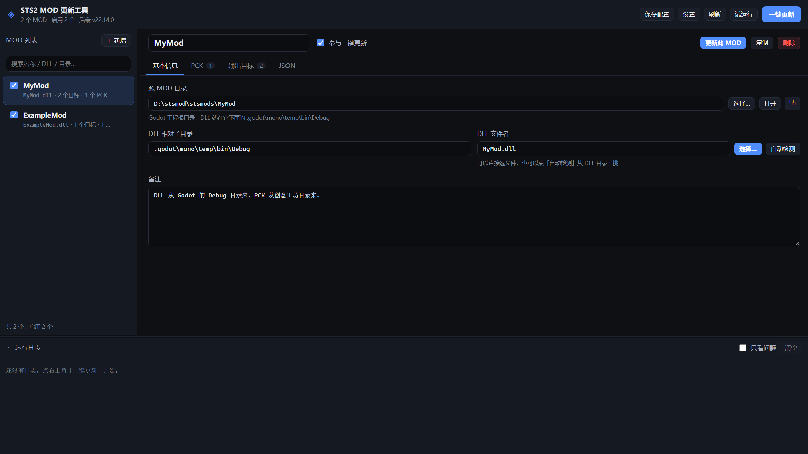

# STS2 MOD 更新工具

> 仓库：<https://github.com/ztmyyoa/sts2MODUpdateTool>

一个本机小工具：Godot 构建出 `DLL` 之后，点一次按钮，把文件搬到 GitHub 仓库目录和 Steam 创意工坊目录，跑完两个上传脚本，日志实时显示。

这个仓库只有工具本体一个项目：

| 目录 | 是什么 | 技术栈 |
| --- | --- | --- |
| [`updatemod/`](updatemod) | 工具本体，浏览器里用的界面 + 一个本地 Node 服务 | Vue 3 + Vite + TypeScript + 原生 Node（零运行时依赖） |

用法细节看 [`updatemod/README.md`](updatemod/README.md)。



## 快速开始（工具本体）

```bash
cd updatemod
npm install
npm run app        # 构建前端 + 起本地服务，浏览器自动打开 127.0.0.1:5178
```

Windows 上也可以直接双击 `updatemod\启动.bat`。

第一次打开列表是空的，点左边「＋ 新增」按自己的目录结构配一个 MOD；配置存在 `updatemod/config/app.config.json`，
这个文件里有本机绝对路径，**已在 `.gitignore` 里**，不会被提交。仓库里只有一份 `config/app.config.example.json` 作参考。

## 说明

- 不联网、不上报、不写注册表；所有复制和脚本执行都在本机完成。
- 上传和 `git push` 是靠你自己已有的 `.bat` 脚本完成的，工具只负责按顺序调用。
- 工具的界面、日志、隐私处理（Steam 账号密码打码）等细节见 [`updatemod/README.md`](updatemod/README.md)。
- 许可：[MIT](LICENSE)。
