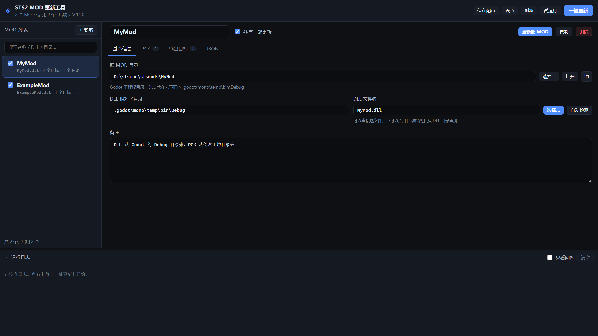

# STS2 MOD 更新工具

给《Slay the Spire 2》MOD 作者用的**本地小工具**：在 Godot 里构建出 DLL / PCK 之后，点一下
「一键更新」，它就把文件复制到 Steam MOD 目录和 GitHub 仓库目录，再顺手跑那两个上传脚本，日志实时刷在新窗口里。

纯本地运行，不联网、不上传任何数据，不依赖 Electron（就是一个 Node 小服务和一张网页）。

介绍视频：<https://www.bilibili.com/video/BV1GQySzoEuM/>

界面截图：

```
stsmods\<MOD>\.godot\mono\temp\bin\Debug\<MOD>.dll   ─┐
创意工坊\content\2868840\<工坊ID>\<MOD>.pck          ─┼─→  modmaker\SteamMOD\<MOD>\paks\            ( + mod_create.bat )
                                                      │
                                                      └─→  ...\mods_finished\<MOD>\                 ( + <MOD>.bat )
```

## 它解决什么麻烦

做 MOD 的时候每次发版都要重复这几件事，很容易漏：

- 从 `.godot\mono\temp\bin\Debug\` 里挑出刚编好的 DLL；
- 从创意工坊缓存目录里找出这次的 PCK；
- 分别塞进 Steam 上传目录和 GitHub 仓库目录；
- 更新 mod 的 JSON（版本号、has_pck / has_dll 之类）；
- 依次跑 `mod_create.bat`（steamcmd 上传）和仓库的 `git add/commit/push` 脚本。

这工具把这些绑成一个按钮，并且把过程**逐行打印出来**：哪个文件从哪复制到哪、脚本输出了什么、退出码是多少。

## 功能

- **一键更新**：一次处理所有勾选的 MOD，每个 MOD 可配多个输出目标。
- **试运行**：只打印“将要做什么”，不复制、不跑脚本，配置完先看一眼很稳。
- **配置可视化**：源目录、DLL、PCK、JSON、目标目录、脚本全都能在界面里改，新增 MOD 不用改代码。
- **页面内文件浏览器**：选路径不弹系统对话框（原因见下面 FAQ），点「选择…」直接在本页浏览磁盘。
- **JSON 编辑器**：在界面里直接改 mod 的 JSON，带格式化和语法校验，保存即写盘。
- **实时日志**：SSE 推流，按级别上色；可「只看问题」过滤警告和错误。
- **隐私保护**：日志里的 steamcmd 账号密码自动打码成 `***`。
- **Steam 手机令牌提醒**：Steam 脚本一开跑就提前弹提示框（不等 steamcmd 输出，因为它输出有缓冲）+ 响铃 + 改浏览器标题，框里还有已等待秒数。

## 环境要求

- Windows 10 / 11（要调 `cmd.exe`、`explorer.exe`）。
- Node.js 20 以上（推荐 22 LTS）。`node -v` 能出版本号就行。

## 快速开始

```bat
cd /d <你放这个项目的目录>
npm install
npm run app
```

`npm run app` 会先打包前端、再启动本地服务，然后自动打开浏览器（默认 <http://127.0.0.1:5178>）。
以后每次只要 `npm run app`，或者直接双击项目里的 `启动.bat`（它会自动补 `npm install` 和打包）。

第一次进界面是**空列表**，因为不同人的目录结构差别很大，所以没有预填任何 MOD。

## 日常更新一个 MOD

1. Godot 里 Build 出新的 DLL / PCK。
2. 左边选中 MOD，核对「PCK」页里勾的是不是这次的 PCK（可以点「扫描创意工坊」重挑）。
3. 点右上角 **一键更新**（第一次建议先点 **试运行**）。
4. 看底部日志：复制了哪些文件、脚本输出、成功还是失败。
5. 跑到 Steam 上传那一步会提前弹「需要你在手机上操作」——这时候把手机拿出来，**60 秒内**去 Steam App 点确认（steamcmd 自己的等待时间就 60 秒左右）。

更新前会自动保存一次配置，所以不用每次手动点保存。

## 加一个新 MOD

1. 点左侧「＋ 新增」，打开新增对话框。
2. 填 MOD 名（建议和 `stsmods\` 下的文件夹名一致），然后逐个挑路径：
   - **源 MOD 目录**：点「选择…」浏览到 Godot 工程根目录（也可以留空，按模板生成）；
   - **DLL**：填相对子目录，再点「选择…」直接挑 `.dll`——选完会自动把相对子目录对齐；
   - **JSON**：点「选择…」挑这个 MOD 的 json 文件；
   - **PCK**：先挑「PCK 来源目录」，再点「选择 PCK 文件…」把这次要复制的 pck 加进列表（可以加多个，也能逐个移除）；
   - **输出目标**：Steam 上传目录、GitHub 仓库目录和各自的脚本，都能单独挑；不想用某个就取消勾选。
3. 懒得一个个挑？点左下角「按模板填入」，会按「设置 → 路径模板」把空着的字段补上（`{mod}` 换成 MOD 名），填完照样能改。
4. 创建以后还能在右侧编辑器里随时改；先「试运行」看一遍计划，没问题再「一键更新」。

## 界面说明

| 位置 | 作用 |
| --- | --- |
| 顶部工具栏 | 保存配置 / 设置 / 刷新 / 试运行 / 一键更新 |
| 左侧列表 | 搜索框可按名字 / DLL / 目录过滤；勾选 = 参与「一键更新」；点条目编辑；✕ 删除这条配置（不动磁盘文件） |
| 编辑器标题栏 | 「更新此 MOD」只跑这一个；「复制」复制一份配置；「删除」删掉这条配置 |
| 基本信息 | 源 MOD 目录、DLL 子目录、DLL 文件名；可点「选择…」浏览磁盘直接挑 `.dll`，也可点「自动检测」 |
| PCK | 点「选择 PCK 文件…」直接挑 `.pck`，或扫描创意工坊目录后逐个添加（也支持手敲相对路径） |
| 输出目标 | 每个目标 = 一个目录 + 一个可选脚本 + 复制哪些文件（DLL / PCK / JSON） |
| JSON | 直接编辑目标 JSON，保存写回磁盘 |
| 底部日志 | 实时输出，可暂停滚动、「只看问题」、清空、中止 |

**布局可以自己拉**：左侧列表和右侧编辑器之间有一条竖线，拖它改列表宽度；日志栏上方有一条横线，拖它改日志高度。双击分隔线恢复默认。拉过的尺寸记在浏览器里，下次打开还是老样子。

**试运行**和**一键更新**的唯一区别：试运行不碰磁盘、不跑脚本。

## 一次更新到底做了什么

对每个勾选的 MOD，按顺序：

1. 解析 DLL：没填名字就在 `DLL 子目录` 里找唯一的 `.dll`，找不到就跳过并标红。
2. 逐个输出目标：
   - 复制 DLL / PCK / JSON 到目标目录（同名直接覆盖；源和目标是同一个文件时跳过）；
   - 如果该目标配了脚本，等复制完再执行它，并把脚本输出逐行打进日志；
   - 脚本退出码非 0 只标红，不会中断后面的目标。
3. 最后打印汇总：复制了几个、跳过几个、失败几个、脚本成功几个。

脚本的输出会**逐行判断编码**（先 UTF-8，不合法再 GBK），所以 steamcmd 的中文提示不会乱码。

## 配置文件

位置：`config/app.config.json`。首次启动自动生成，**已在 `.gitignore` 里**，不会被提交。

- 想分享给别人 / 开源：仓库里只保留 `config/app.config.example.json`（示例，字段全但路径是假的）。
- 想换机器：把这个文件复制过去，或者在新机器上重新配一遍。
- 想手改：格式就是普通 JSON，字段含义：

| 字段 | 说明 |
| --- | --- |
| `global.workshopDir` | 创意工坊缓存根目录，例如 `...\workshop\content\2868840` |
| `global.openBrowser` | 启动服务后是否自动开浏览器 |
| `global.scriptTimeoutMs` | 单个脚本的超时时间（毫秒），超时会 `taskkill` 掉 |
| `templates.*` | 新增 MOD 时的路径模板，`{mod}` 占位符会被替换 |
| `mods[].name` | MOD 名称，同时用于日志里区分 |
| `mods[].enabled` | 是否参与「一键更新」 |
| `mods[].sourceDir` | Godot 工程目录（DLL 所在项目的根） |
| `mods[].dllSubPath` | DLL 相对源目录的子路径，默认 `.godot\mono\temp\bin\Debug` |
| `mods[].dllName` | DLL 文件名，留空则自动探测 |
| `mods[].pckSourceDir` / `pckFiles` | PCK 所在目录 + 要复制的文件名 |
| `mods[].jsonPath` | 要编辑 / 复制的 JSON 路径 |
| `mods[].targets[]` | 输出目标：`dir` 目标目录、`script` 可选脚本、`copyDll/copyPck/copyJson` 复制开关 |

## 常见问题

**为什么选路径不是系统对话框？**
一开始确实用的是 PowerShell 弹系统文件夹选择框，但那个对话框由后台进程弹出，Windows 不允许后台进程抢到前台，
窗口创建了却看不见（点「选择…」毫无反应）。改成页面内的文件浏览器后就没这个问题了。

**日志里的账号密码安全吗？**
安全。程序在跑之前会读每个目标脚本，把里面的 `+login 用户名 密码` 提取成敏感词表，
日志出口统一替换成 `***`；连 `Logging in user '...'` 里的用户名也会被遮掉。配置文件里不存密码。

**提示「Steam 正在等待手机确认登录」，我只等了半分钟就失败了？**
steamcmd 自己的等待时间就是 60 秒左右，工具没法延长。所以带 `+login` 的 Steam 脚本一开跑就会先弹提示，
把手机拿出来等着就行；超时了再点一次「一键更新」即可（文件复制是覆盖，重跑没有副作用）。

**日志里出现一堆方框 `锟斤拷` / `���`？**
如果来自 steamcmd，说明编码没判断对（本工具已处理）；如果来自 `.bat` 里 `echo` 的中文，
那是 cmd 读 GBK 存盘脚本的问题（本机系统区域设置是 UTF-8 时尤其明显），只影响回显、不影响更新。
要彻底干净，可以把那些 bat 另存为 UTF-8 编码，或者去掉中文 `echo`。

**脚本里有 `pause`，会不会卡住？**
不会。子进程的 stdin 接的是 NUL，`pause` 会立刻返回。

**5178 端口被占用？**
服务会自动往后找可用端口（最多试 10 次），以启动时打印的地址为准。

**浏览器白屏 / 提示「前端还没构建」？**
`npm run build` 之后再 `npm start`，或者直接用 `npm run app`（会先打包再启动）。

## 目录结构

```
server/
  index.mjs          本地 HTTP 服务 + 所有 /api 接口
  config.mjs         配置读写与清洗、新建 MOD 的模板
  update-runner.mjs  复制 / 执行脚本 / 日志打码（SSE 逐条吐日志）
  static.mjs         把 dist/ 端出去
scripts/dev.mjs      开发模式：vite + 后端一起起
src/
  App.vue            主界面（三栏 + 底部日志）
  components/        侧边栏、编辑器、路径输入、文件浏览器、日志、设置
  lib/api.ts         所有请求 + SSE 流解析
  lib/types.ts       前后端共用的数据结构
config/
  app.config.example.json  配置示例（可提交）
```

## 开发

```bat
npm run dev:all
```

同时启动 vite（5173，热更新）和本地服务（5178），前端的 `/api` 会被代理过去，改前端在 <http://localhost:5173> 看效果。

| 命令 | 作用 |
| --- | --- |
| `npm run dev` | 只起 vite（需要后端另开） |
| `npm run dev:all` | 开发模式，前后端一起 |
| `npm run build` | 只打包前端到 `dist/` |
| `npm run type-check` | 类型检查（vue-tsc） |
| `npm run app` | 打包 + 启动服务 + 开浏览器 |
| `npm start` | 只启动服务（前端需已打包） |

## 隐私与开源

- 所有操作都在本机完成，不联网、不埋点、不收集任何数据。
- `config/app.config.json` 里是本机绝对路径、MOD 名单、工坊 ID，**已在 `.gitignore` 里**；
  提交前请确认 `git status` 里没有它。
- 代码里没有硬编码任何人的账号、密码或私有路径，默认配置是空的，示例配置用的是 `YourMod` 这种假名字。
- 许可证：仓库里还没有 `LICENSE`，你可以按需要补一个（MIT 最适合这种小工具）。

## 注意

- 只支持 Windows。
- 复制是**覆盖**：同名文件直接盖掉，不备份，重要文件请自己留个底。
- 一个目标的脚本跑完才会进入下一个目标；脚本失败只标红，不中断其它目标。
